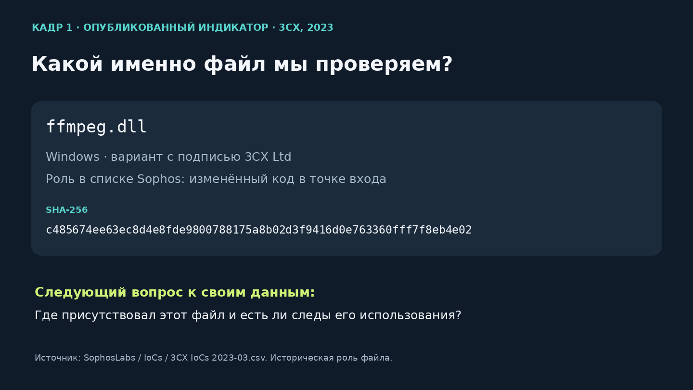
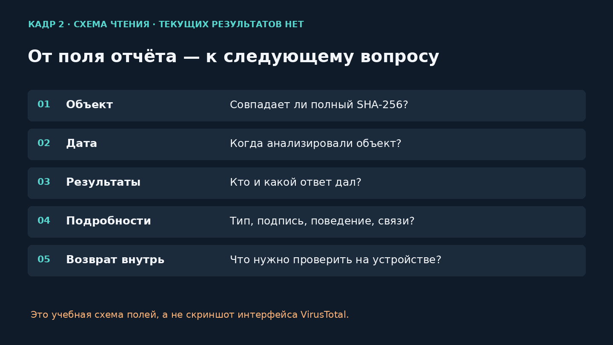

# Загуглить противника: дело об обновлении 3CX

Threat Intelligence для начинающих • Самостоятельный доклад для младших курсов

25 минут + отдельное время на вопросы. Спикер: [Имя, должность], [Компания]. Исследование и проверка документации: 14 октября 2026 года. Реальный центральный кейс: компрометация настольного клиента 3CX в 2023 году. В основной истории разбирается Windows-путь; особенности macOS в него не переносятся.

## 1. Концепция

Главный вопрос: **«Официальная программа подписана и работает. Что ещё нужно проверить, если защита предупреждает об опасности?»**

Доклад для студентов первых–вторых курсов и начинающих специалистов, которые ещё не работали в SOC — центре мониторинга безопасности. Предварительное знание реверса, устройства DLL и языка запросов не требуется. Каждый новый термин появляется после вопроса, ради которого он нужен.

После выступления слушатель сможет выделить IP, домен, URL или точный файл из события, выбрать внешний источник, прочитать содержание и дату отчёта, затем сформулировать проверку во внутренних журналах. Результат — короткая заметка с основаниями, ограничениями и следующим действием.

Сюжетная схема: **событие → вопрос → источник → интерпретация → внутренняя проверка → вывод**. На экране одна «папка дела»: карточки **«Знаем / Предполагаем / Проверяем»**. Карточки открываются постепенно, поэтому аудитория учится не только получать сведения, но и различать их статус.

### Два варианта истории внутри 3CX

| Вариант | Маршрут | Почему может увлечь | Ограничение |
| --- | --- | --- | --- |
| **А. «Программа подписана. Почему сработала защита?»** | Учебное предупреждение после обновления → что означает доверие к источнику и подписи → приложение как набор компонентов → точный хеш → внешние сведения → собственные события. | Знакомая ситуация и понятное противоречие. Слушатель постепенно уточняет решение, а не пытается сразу понять устройство вредоноса. | Не выдавать учебный спор о предупреждении за реальный диалог в компании. |
| **Б. «Один хеш — сколько компьютеров?»** | Опубликованный хеш → его роль → затронутые версии → устройства с таким комплектом → свидетельства запуска и сетевых действий. | Быстро показывает практическую пользу TI и масштабирование проверки. | 64 символа в начале выглядят как непонятная техническая задача; слабее вовлекают младшие курсы. |

Выбран вариант А. Сильный переход варианта Б используется во второй половине: сведения о конкретном файле превращаются в вопросы к парку устройств. Полная история первоначального взлома поставщика, расшифровка нагрузки и международная атрибуция остаются за пределами основной речи.

### Три приёма подачи

1. **Улики по одной.** Сначала привычная программа и предупреждение; затем компоненты, хеш, сетевой путь, внутренние данные. Цвет карточки обозначает учебное условие, опубликованный факт или гипотезу.
2. **Повторное решение.** После новой улики слушатель снова выбирает следующий вопрос. Не просим угадать вероятность атаки и не проверяем знание незнакомых терминов.
3. **Зум «продукт → файл → действие».** Схема приложения распадается на компоненты, один выделяется, затем появляется вопрос о его использовании. Условная схема не подменяет логи.

Три коротких вопроса залу находятся в середине — блоки 4, 8 и 11. На каждый отведены 5–8 секунд. Развёрнутое обсуждение — после доклада.

## 2. Исследование: фактическая основа и границы

### Что подтверждено первоисточниками

| Факт | Основание и граница |
| --- | --- |
| В марте 2023 года обнаружена компрометация настольного клиента 3CX, программы для звонков с компьютера. | SentinelOne, Sophos и официальное предупреждение 3CX. Это исторический инцидент, а не оценка текущей версии продукта. [C1, C3, C6] |
| В Windows-пакете исследователи различают чистый `3CXDesktopApp.exe`, изменённый `ffmpeg.dll` и `d3dcompiler_47.dll` с добавленной нагрузкой. | Sophos и Unit 42. Проверка только основного EXE не охватывает весь комплект — наш учебный вывод из устройства цепочки, а не приписанная конкретному аналитику ошибка. [C1, C4] |
| Один опубликованный изменённый `ffmpeg.dll` подписан 3CX Ltd. | Точная строка списка Sophos с SHA-256 `c485…4e02`. Наличие подписи не является гарантией невредоносности. Актуальное состояние подписи в VT здесь не проверено. [C2] |
| В Windows-цепочке специальные ICO-файлы содержали сведения для получения адреса следующего сетевого шага. | SentinelOne и Unit 42. Не говорить, что пользователь запускал «заражённую картинку», или что весь GitHub является вредоносным. [C3–C4] |
| `msedgepackageinfo[.]com/microsoft-edge` — один из опубликованных сетевых примеров Windows-кампании. | Unit 42, таблица 1, `icon13.ico`. Это не доказательство обращения выбранного экземпляра DLL либо нашего учебного компьютера. [C4] |
| `msedgepackageinfo[.]com` наблюдался с IP `185.38.151[.]11` 9 января 2023 года. | Mandiant, таблица 3. Связь историческая, не текущий DNS и не гарантия того же IP в марте. Контекст таблицы — слабое пересечение инфраструктуры разных кластеров, а не доказательство единого оператора. [C5] |
| Windows-версии в предупреждении 3CX: `18.12.407` и `18.12.416`. | Официальное предупреждение 30 марта 2023. Не переносить список на все платформы и версии. [C6] |

### Короткая хронология

- **22 марта 2023:** SentinelOne отмечает поведенческие детекты; пользователи обсуждают возможные ложные срабатывания — по опубликованным исследованиям. [C1, C3]
- **29 марта:** публикация SentinelOne и выявление активности Sophos MDR. [C1, C3]
- **30 марта:** официальное предупреждение 3CX. [C6]
- **20 апреля:** Mandiant публикует результаты расследования происхождения компрометации. Эти сведения не были всем известны в первый день. [C5]

Доступные статьи содержат позднейшие обновления. Речь не разыгрывает их полный текст как знание аналитика на 22 марта. Она рассматривает историческую ситуацию с сегодняшним доступом к опубликованным материалам.

### Как не смешать разные утверждения

«Этот файл описан исследователем как вредоносный», «он находился на нашем устройстве», «его код исполнялся» и «устройство обращалось к инфраструктуре» — четыре разных утверждения. Каждому нужен свой источник.

Учебное событие, диалоги и вопросы к устройствам придуманы для объяснения метода и явно подписаны. Реальные исследования принадлежат Sophos, SentinelOne, Unit 42, Mandiant и другим указанным авторам. Выводов внутреннего расследования компании спикера в материале нет.

### Пять изученных выступлений и практических разборов

Видеозаписи не просмотрены. «Приём» и оценка сложности ниже — редакторский анализ полученных материалов.

| Материал: название, автор, год | Что действительно изучено и на чём построен рассказ | Приём для нашего доклада | Что оставить за пределами младших курсов |
| --- | --- | --- | --- |
| [Mac-ing Sense of the 3CX Supply Chain Attack: Analysis of the macOS Payloads](https://speakerdeck.com/patrickwardle/mac-ing-sense-of-the-3cx-supply-chain-attack-analysis-of-the-macos-payloads), Patrick Wardle, 2023; VB2023 | Авторские слайды и их текст, 63 слайда. От известной атаки — к компонентам и наблюдаемому поведению на macOS. | «Игла в стоге»: постепенно перейти от большого приложения к точному компоненту. Заимствуем форму, не переносим сведения о dylib на DLL. | Отладчик, ассемблер, регистры и несколько нагрузок одновременно. |
| [3CX users under DLL-sideloading attack: What you need to know](https://www.sophos.com/en-gb/blog/3cx-dll-sideloading-attack), Sophos X-Ops: Greg Iddon и соавторы, 2023 | Письменный практический разбор, схемы и запросы. Подозрение → механизм → проверки устройств. Последняя указанная редакция — 6 апреля. | Три понятных вопроса: затронутая версия? точный файл? соответствующие сетевые действия? | Продуктовые названия таблиц, длинный SQL и весь список доменов. |
| [Effective Threat Intel](https://speakerdeck.com/ashelmire/effective-threat-intel-sans-cti-summit-2017), Aaron Shelmire, SANS CTI Summit, 2017 | Текст 19 авторских слайдов. От полезности решения — к контексту совпадений. | Вести одну карточку события и после каждого обогащения менять следующий вопрос. | Старую статистику и подробные метрики качества источников. |
| [The Art of Pivoting — How You Can Discover More from Adversaries with Existing Information](https://ail-project.org/assets/img/slides/the-art-of-pivoting.pdf), Alexandre Dulaunoy, FIRST CTI, 2025 | Текст 22 слайдов. Переходы по связям с проверкой оснований. | Каждая стрелка схемы получает подпись: откуда известна связь и к какому времени она относится. | Каталог favicon, DOM, QR, ключей и Tor. |
| [Confidence in Chaos: Strategies for World-Class Security Operations](https://i.blackhat.com/EU-22/Wednesday-Briefings/EU-22-Knerler-Zimmerman-Confidence-in-Chaos.pdf), Kathryn Knerler, Carson Zimmerman, Black Hat Europe, 2022 | Текст 21 слайда. TI встроен в процесс SOC и работу с внутренними данными. | Закончить историю вопросом к собственным устройствам, а не названием группы. | Полную архитектуру SOC и все 11 стратегий. |

## 3. План на 25 минут

| Время | Слайды | Вопрос блока |
| --- | --- | --- |
| 00:00–03:30 | 1–2 | Что известно об исходном событии и реальном кейсе? |
| 03:30–06:55 | 3–4 | Какой компонент и какие точные байты проверяем? |
| 06:55–10:10 | 5–6 | Что говорит отчёт и что раскрывает запрос? |
| 10:10–11:50 | 7 | Короткий разбор опубликованного хеша. |
| 11:50–15:55 | 8–9 | Как перейти к сетевому объекту, сохранив время и основание? |
| 15:55–21:10 | 10–12 | Что произошло на нашем устройстве и как записать вывод? |
| 21:10–25:00 | 13–14 | Что искать в истории и какой следующий шаг? |

Заголовки, ссылки и комментарии не произносятся. Демонстрация включена в 25 минут. Вопросы после доклада — отдельно. Длительность устанавливается репетицией, расчёт является ориентиром.

## 4. Полный текст устного выступления

Произносимая часть: **2699 слов**, из них 100 — реплики демонстрации. Ориентир: около **116 слов в минуту** вне демонстрации, **1:40** на демонстрацию и примерно **50 секунд** на короткие паузы и переходы. Это расчёт, фактическая длительность определяется репетицией. Заголовки, пометы в квадратных скобках и редакторские основания не произносятся.

### Слайд 1. Программа официальная. Почему предупреждение? • 00:00–01:50

[Учебная ситуация. На экране три карточки: привычное приложение / обновление / предупреждение.]

Представьте: март две тысячи двадцать третьего года. Вы помогаете разбирать обращения сотрудников. Приходит сообщение: «Обновился телефонный клиент, защита дала предупреждение. Но программа официальная, подписана и до этого нормально работала. Мне через десять минут звонить. Можно продолжать?»

Вот наше небольшое дело на сегодня. Оно учебное: этот сотрудник придуман. Мы ещё не видели его компьютер, не прочитали журналы и не знаем причину предупреждения. Пока у нас есть только слова человека и вопрос, на который хочется быстро ответить.

Я [Спикер], представляю [Компания]. Сегодня мы разберём реальную историю программы 3CX и попробуем понять, что с ней должен делать начинающий аналитик. Без разбора машинного кода. Будем открывать сведения по одному и каждый раз выбирать следующий вопрос.

В работе с угрозами это называют Threat Intelligence: сведения об угрозах, которые помогают принимать решения по защите. Сложное название, но понятная задача. Узнать, что известно другим, проверить основания и применить к своей ситуации.

В конце вернёмся к сотруднику. Хороший ответ должен объяснять, что именно мы проверили и какое действие следует дальше. Одной фразы «программа знакомая» для этого пока мало.

Для начала не нужно уметь анализировать вирусы. Достаточно удерживать три карточки: что уже известно, что мы предполагаем и что можем проверить. Они останутся рядом с нами до конца этой истории.

[Короткая пауза перед открытием первой улики.]

### Слайд 2. За учебным вопросом — реальная история • 01:50–03:30

3CX Desktop App — приложение для рабочих звонков. В марте две тысячи двадцать третьего года привычное обновление этой программы стало способом доставки вредоносного кода.

На экране три даты. Двадцать второго марта исследователи SentinelOne наблюдали всплеск предупреждений о поведении программы; пользователи также обсуждали возможные ложные срабатывания. Двадцать девятого марта появились публичные исследования. Тридцатого марта сама 3CX опубликовала предупреждение о затронутых версиях.

Для Windows в нём указаны две версии: восемнадцать, двенадцать, четыреста семь и восемнадцать, двенадцать, четыреста шестнадцать. Они записаны на слайде. Это исторический список конкретного приложения, а не утверждение про все продукты 3CX.

Даты на шкале обозначают разные вещи: первое наблюдение, публикацию исследования и сообщение поставщика. Не стоит читать поздний подробный отчёт так, будто вся эта информация уже была известна в начале марта.

Позже расследование Mandiant установило, что была взломана среда, где поставщик собирал программу. Таким атакам дают название «атака на цепочку поставки». Человек получает программу привычным способом, но нежелательный код попадает в неё раньше, на стороне поставщика.

В нашем деле это меняет вопрос. Мы теперь спрашиваем: какой именно комплект получил сотрудник? Но опубликованная история ещё не доказывает, что его компьютер затронут. Чтобы проверить комплект, сначала заглянем внутрь приложения.

*Редакторское основание, не произносить: [C1: Sophos](https://www.sophos.com/en-gb/blog/3cx-dll-sideloading-attack), [C3: SentinelOne](https://www.sentinelone.com/blog/smoothoperator-ongoing-campaign-trojanizes-3cx-software-in-software-supply-chain-attack/), [C6: 3CX](https://www.3cx.com/blog/news/desktopapp-security-alert/), [C5: Mandiant](https://cloud.google.com/blog/topics/threat-intelligence/3cx-software-supply-chain-compromise).*

### Слайд 3. Программа — это несколько компонентов • 03:30–05:10

Обычно мы представляем приложение как одну иконку. Нажали — появились окно и кнопки. На диске за этой иконкой может находиться целый набор файлов.

Посмотрим на схему Windows из исследования Sophos. Основной файл, который запускает приложение, называется 3CXDesktopApp.exe. В изученном комплекте он был чистым. Но рядом находилась изменённая библиотека ffmpeg.dll и ещё одна библиотека с добавленной скрытой нагрузкой.

Библиотека — файл с готовыми функциями, к которым обращается программа. Можно представить набор инструментов: основная программа выполняет задачу и берёт нужные инструменты из соседних файлов. Расширение DLL указывает на такой тип библиотеки в Windows. Для сегодняшнего рассказа этого достаточно.

Изменённая ffmpeg.dll продолжала выполнять обычные функции. Поэтому привычное окно и работающие звонки не опровергали проблему. Дополнительный код мог работать вместе с обычным поведением.

Здесь возможна важная ловушка: проверить главный файл и решить, что проверено приложение целиком. В реальном кейсе исследователи нашли проблему в другом компоненте. Это возможная ошибка нашего учебного подхода, а не результат выполненной нами проверки.

Не нужно запоминать все названия на схеме. Нужно запомнить следующий вопрос: какой файл вызвал подозрение и какой файл мы фактически проверяем? Теперь увеличим одну библиотеку. Как отличить именно её от тысяч нормальных файлов с таким же именем?

*Редакторское основание, не произносить: [C1: Sophos](https://www.sophos.com/en-gb/blog/3cx-dll-sideloading-attack), [C4: Unit 42](https://unit42.paloaltonetworks.com/3cxdesktopapp-supply-chain-attack/).*

### Слайд 4. Имя не определяет содержимое • 05:10–06:55

Первый вопрос к вам: два файла называются ffmpeg.dll. Как проверить, одинаковое ли у них содержимое: сравнить имена или вычислить отпечаток содержимого?

[Дать залу 5–8 секунд.]

Имя можно изменить. Отпечаток вычисляется по содержимому. Такой отпечаток называют хешем. Сегодня используем SHA-256. Длинную строку из шестидесяти четырёх символов читать вслух не будем: её копируют и сравнивают целиком.

В практической проверке SHA-256 позволяет различать конкретное содержимое, независимо от имени файла. Но сам по себе отпечаток не сообщает, хороший файл или плохой.

На практике его вычисляет инструмент; вручную эту строку не собирают. Нам важно не обрезать её при сравнении и не перепутать отпечаток библиотеки с отпечатком всего установщика.

Файл, хеш, адрес или домен — наблюдаемые объекты: то, что мы увидели. Домен — имя ресурса, IP — сетевой адрес, URL — полная ссылка с конкретным путём. Индикатор компрометации, или IoC, — признак, который с понятным основанием помогает подозревать нежелательное действие. Основание, источник и время здесь обязательны.

У нас будут файловые признаки, например хеш, и сетевые, например домен. Отдельно сохраняем контекст: версию, устройство, время. Опубликованный вредоносный хеш помогает проверить точное совпадение. Как он оказался на компьютере и запускался ли — другие вопросы. Сначала найдём сведения об этом конкретном объекте.

*Редакторское основание, не произносить: [N1: NIST IoC](https://csrc.nist.gov/glossary/term/indicator_of_compromise), [N2: Microsoft Get-FileHash](https://learn.microsoft.com/en-us/powershell/module/microsoft.powershell.utility/get-filehash).*

### Слайд 5. VirusTotal: прочитать, а не угадать • 06:55–08:50

В списке Sophos опубликован точный хеш изменённой ffmpeg.dll. Исследователи отдельно указали, что этот вариант был подписан 3CX. Подпись помогает определить подписавшего и проверить целостность подписанного содержимого, но не обещает безопасность всех действий программы. В атаке на поставщика это особенно важно.

По хешу можно искать готовый отчёт VirusTotal. Сервис собирает результаты разных средств проверки и дополнительные сведения об объекте. Начинаем с двух простых вещей: тот ли полный хеш и когда проводился анализ?

Дальше читаем результаты. Malicious означает, что средство считает объект вредоносным. Undetected — что оно не дало обнаружения или не выразило мнение. Harmless — отдельное мнение о невредоносности. Таймаут означает, что проверка не дала полноценного результата. Это разные ответы.

Число обнаружений не равно вероятности атаки. Если один результат из нескольких подозрительный, это повод разобраться в причине; возможны ложные срабатывания. Если обнаружений нет, безопасность тоже не гарантирована. Средства могли ещё не знать о проблеме или не увидеть нужное поведение.

После счётчика смотрим тип файла, сведения о подписи, наблюдаемое поведение и связи. Отчёт может объяснить возможности файла. А факт его запуска на компьютере сотрудника нужно проверять отдельно.

И сегодняшний отчёт не обязательно выглядит так, как в первый день атаки. За прошедшее время средства проверки могли получить новые знания. Поэтому дату результата сохраняем вместе с самим результатом.

Прежде чем открыть поиск, остановимся ещё на одном практическом вопросе: какие данные мы собираемся отправить наружу?

*Редакторское основание, не произносить: [C2: Sophos CSV](https://raw.githubusercontent.com/sophoslabs/IoCs/master/3CX%20IoCs%202023-03.csv), [D3: VT Analysis](https://docs.virustotal.com/reference/analyses-object), [D4: VT File object](https://docs.virustotal.com/reference/files), [D6: VT false positives](https://docs.virustotal.com/docs/virustotal-intelligence-introduction), [N2: Microsoft Authenticode / хеш](https://learn.microsoft.com/en-us/windows-hardware/drivers/install/authenticode).*

### Слайд 6. Поиск отчёта и передача файла • 08:50–10:10

Внешний сервис полезен, но запрос тоже является передачей сведений. Сегодня используем уже опубликованный хеш исследователей. Для него не нужно брать файл с рабочего компьютера и загружать его содержимое.

Поиск готового отчёта и загрузка файла — разные действия. При загрузке сервис получает сами байты. При поиске по хешу мы передаём идентификатор. При этом актуальная документация VirusTotal предупреждает о включении переданных или запрошенных индикаторов в набор данных, доступный сообществу. Поэтому произвольный поиск не стоит считать автоматически приватным.

В реальной работе действуют правила компании и условия сервиса. Внутренний документ, личные данные или ссылка с токеном доступа не должны случайно оказаться во внешнем анализе. Токен — секретная строка, которая иногда даёт доступ к ресурсу без дополнительного входа.

Для демонстрации достаточно публичного объекта и чтения существующего отчёта. Мы не скачиваем образец, не запускаем его и не запрашиваем новый анализ. Если правила работы не разрешают внешний запрос, вопрос решается доступными внутренними средствами. Теперь покажу, как выглядит наша проверка в минимальном объёме.

*Редакторское основание, не произносить: [D5: VT Searching](https://docs.virustotal.com/docs/searching).*

### Слайд 7. Демонстрация: один хеш, один вопрос • 10:10–11:50

[100 секунд вместе с переключением и наведением. Основной готовый резерв: строка CSV Sophos и схема полей отчёта. Значения из недоступной текущей карточки не изображать.]

Вот строка опубликованного списка Sophos: имя файла, полный SHA-256, платформа и пояснение исследователей. Мы смотрим на конкретную библиотеку, а не на название продукта вообще.

В готовом отчёте VirusTotal первым делом сравниваем полный хеш. Затем ищем дату последнего анализа и читаем результаты с их названиями. Далее — тип и сведения о подписи, если они доступны.

Текущую карточку при подготовке получить не удалось, поэтому на резервном экране показана структура полей без выдуманных оценок. Опубликованная строка — реальный источник, схема — подсказка, как читать отчёт.

Результат этого шага: у нас есть точный объект для поиска на устройствах. Но прежде выясним, какие действия исследователи связали с атакой.

*Редакторское основание, не произносить: [C2: Sophos CSV](https://raw.githubusercontent.com/sophoslabs/IoCs/master/3CX%20IoCs%202023-03.csv), [D3: VT Analysis](https://docs.virustotal.com/reference/analyses-object), [D4: VT File object](https://docs.virustotal.com/reference/files).*

### Слайд 8. Картинка с адресом следующего шага • 11:50–13:50

Здесь у истории появляется необычный поворот. В Windows-цепочке программа обращалась к файлам иконок на GitHub. Иконка выглядит как обычная маленькая картинка, но в исследованных файлах были спрятаны сведения об адресе следующего шага. Код извлекал их и получал адрес сервера для дальнейшего взаимодействия.

Второй вопрос к вам: программа обратилась к GitHub. Хватит ли этого, чтобы объявить соединение вредоносным?

[Дать залу 5–8 секунд.]

Нет. GitHub используют многие нормальные проекты. Здесь важны конкретный путь, время обращения и программа, которая обратилась. Запущенную программу называют процессом. На слайде выделен путь IconStorages, images, main. В исследовании Unit 42 для одной из иконок показан извлечённый адрес с доменом msedgepackageinfo. Полные строки оставим на экране: их задача — точное сравнение.

Не пользователь открыл картинку и «запустил вирус». Действовал код изменённого компонента. И не любая картинка на GitHub содержит такое указание. Мы обсуждаем конкретный путь из опубликованной атаки.

Теперь наш вопрос к внутренним данным звучит точнее: обращался ли этот телефонный клиент к этому пути в нужное время? Если да, что происходило дальше? Сам факт присутствия библиотеки и сетевое действие — разные ступени проверки.

Остаётся ещё один привычный шаг: что известно о сетевом адресе? Здесь тоже важно не потерять время и источник связи.

Полный адрес страницы и имя домена тоже различаются. Путь помогает выделить конкретный объект на общей площадке. Если источник хранит только домен, точное обращение к нужному файлу по нему не восстановить.

*Редакторское основание, не произносить: [C3: SentinelOne](https://www.sentinelone.com/blog/smoothoperator-ongoing-campaign-trojanizes-3cx-software-in-software-supply-chain-attack/), [C4: Unit 42](https://unit42.paloaltonetworks.com/3cxdesktopapp-supply-chain-attack/).*

### Слайд 9. AbuseIPDB и ловушка времени • 13:50–15:55

В таблице Mandiant есть историческая связь домена msedgepackageinfo с IP, который вы видите на экране. Дата записи — девятое января две тысячи двадцать третьего года. Это датированное наблюдение связи имени и адреса. Оно не устанавливает IP домена на конкретный день марта и не доказывает, что наш учебный компьютер обращался к этому адресу.

DNS — система, которая помогает по имени домена найти сетевой адрес. Сегодняшний ответ может отличаться от ответа три года назад. Адрес мог сменить владельца; на одном адресе могли находиться разные ресурсы. Поэтому текущую связь нельзя незаметно подставить в историческую историю.

Для IP полезен AbuseIPDB: он показывает, что пользователи сообщали об активности с адреса. Смотрим период, даты, категории и содержание сообщений. Жалобы на сканирование не доказывают, что именно к этому серверу наш клиент передавал данные.

Количество сообщений не равно количеству атак. Оценка уверенности сервиса не является вероятностью заражения нашего устройства. Отсутствие жалоб означает отсутствие видимых сообщений в выбранном периоде; серверу управления вовсе не обязательно сканировать чужие компьютеры.

Поэтому этот сервис даёт дополнительный контекст. На главный вопрос «что сделал наш процесс?» отвечают другие данные. И сегодняшние жалобы не восстанавливают состояние адреса в марте две тысячи двадцать третьего года.

Если отчёт открыт, мы читаем фактически видимые поля. Если недоступен, так и записываем. Ссылка на карточку сама по себе ещё не означает, что её содержимое проверено.

Страна и провайдер описывают размещение адреса. По ним нельзя определить, кто управлял атакой. Для нашего следующего шага гораздо полезнее дата наблюдения и связь с конкретным действием.

*Редакторское основание, не произносить: [C5: Mandiant](https://cloud.google.com/blog/topics/threat-intelligence/3cx-software-supply-chain-compromise), [D1: AbuseIPDB CHECK](https://docs.abuseipdb.com/#check-endpoint), [D2: AbuseIPDB FAQ](https://www.abuseipdb.com/faq.html).*

### Слайд 10. Где поиск становится анализом • 15:55–17:45

Давайте остановимся и посмотрим, что изменилось в нашем подходе. Мы начали с предупреждения, узнали, какой компонент описан исследователями, получили его опубликованный отпечаток и сформулировали вопрос о сетевом действии. Файл сотрудника ещё не проверен.

Проверка репутации отвечает: что об объекте сообщают другие? Обогащение добавляет сведения: версия, даты, подпись, связи. Анализ Threat Intelligence оценивает, как эти сведения помогают нашему решению и какие основания у вывода.

Расследование отвечает уже о конкретном событии: что происходило на устройстве сотрудника? А поиск угроз, который также называют hunting, проверяет предположение о похожем поведении в доступной истории других устройств.

Это не пять отдельных профессий, а разные вопросы на нашем пути. Ошибка начинается, когда один ответ подменяет другой: «Сервис знает вредоносный хеш, значит компьютер точно участвовал во всех действиях атаки». Такого вывода у нас пока нет.

Внешние исследования принадлежат Sophos, SentinelOne, Mandiant и Unit 42. Внутренние результаты у нас ещё не получены. Теперь перейдём к тому, что нужно запросить в компании.

Но сначала ещё один поворот из последующего расследования. Как выяснила Mandiant, сотрудник самого поставщика ранее установил другую программу, X_TRADER, которая уже была изменена злоумышленниками. Через неё началось проникновение, завершившееся компрометацией среды сборки 3CX. Один поставщик получил программу от другого взломанного поставщика. Это объясняет происхождение атаки, но не добавляет результатов о нашем учебном устройстве. Теперь проверим его собственную историю.

*Редакторское основание, не произносить: [C5: Mandiant](https://cloud.google.com/blog/topics/threat-intelligence/3cx-software-supply-chain-compromise).*

### Слайд 11. Находится, запускался, обращался • 17:45–19:45

Третий вопрос к вам: сегодня файл не найден. Доказали ли мы, что он никогда не запускался?

[Дать залу 5–8 секунд.]

Нет. Его могли удалить или заменить обновлением. Текущее состояние и история — разные вещи. Поэтому разделим проверку на три уровня.

Первый: что присутствует или присутствовало? Версия приложения, нужные файлы, точные хеши. Второй: что запускалось? Основная программа, загруженные библиотеки — если источник записывает их загрузку. Третий: какие действия наблюдались после запуска? Сетевые обращения, дальнейшие файлы, другие доступные следы.

Защитное средство на устройстве может сохранять запуск программ и часть действий. Этот класс средств называют EDR. Сетевая история может дать направления обращений. Общая система сбора и поиска событий помогает сопоставить записи по устройству и времени. Но состав данных зависит от того, что организация действительно собирает.

Не обязательно появится отдельная новая программа: нежелательный код может выполняться внутри уже запущенного процесса. Поэтому поиск только незнакомых дочерних процессов может пропустить часть истории.

Сначала проверяем охват и сроки хранения. Затем связываем имеющиеся события, учитывая устройство, процесс и время. Отсутствующий журнал отличается от журнала, в котором искали нужное действие и не нашли. А установленная библиотека ещё не доказывает успешное выполнение всей цепочки. Такая осторожность помогает выбрать точное следующее действие.

Два события рядом по времени не обязательно принадлежат одной программе. Если доступен идентификатор процесса, используем его вместе с устройством и временем, чтобы не склеить случайные совпадения.

### Слайд 12. Записать вывод так, чтобы его проверили • 19:45–21:10

Представьте, что другой аналитик продолжает ваше дело завтра. Ему нужны основания решения. Поэтому записываем рядом три вещи: факт, гипотезу и следующий шаг.

Факт из внешнего источника: Sophos связывает определённый хеш библиотеки с атакой. Факт учебной ситуации: сотрудник сообщил о предупреждении после обновления. Внутренняя проверка пока не выполнена.

Гипотеза: на устройстве мог оказаться затронутый комплект. Следующий шаг: уточнить версию, файл, причину предупреждения и доступную историю запуска. Если возникнет новая находка, запись обновится.

Сохраняем ссылку на источник, дату публикации и дату просмотра. Если сведения относятся к определённому периоду, записываем период. Уверенность объясняем основаниями, а пробелы называем прямо.

Например, запись «не нашли» должна пояснять, где искали и за какой срок. Иначе коллега не поймёт, проверили мы весь архив или только сегодняшний список файлов. Это ограничение меняет смысл вывода.

Название группы из исследовательского отчёта не заменяет вывода о нашем устройстве. Для первого решения полезнее знать, какой компонент присутствовал и какие действия подтверждены. Теперь расширим вопрос: могло ли похожее происходить на других компьютерах?

### Слайд 13. Один файл — сколько устройств? • 21:10–23:35

Первый поиск по известным индикаторам понятен: какие устройства содержали затронутые версии, точные хеши или обращались к опубликованным направлениям? Но можно проверить и более широкое предположение о поведении.

Наша учебная гипотеза: после обновления телефонного клиента могли загружаться изменённые библиотеки и появляться новые или неожиданные для него внешние обращения, включая определённые пути файлового хостинга.

Для исторического упражнения выбираем архив с первого марта по тридцатое апреля две тысячи двадцать третьего года. Это условие проверки, а не точная длительность атаки. Сначала выясняем, есть ли вообще такие данные и какие устройства они покрывают.

Первый конкретный запрос: получить список устройств, где запускался телефонный клиент, и сетевые направления этих запусков, если источник умеет связывать сеть с процессом. Если такой связи нет, отдельно сопоставляем источники и отмечаем ограничение. По кандидатам уточнить версии и файлы, сравнить обращения с обычным поведением, проверить согласованные обновления и опубликованные признаки.

Новая версия вполне может законно обратиться к новому серверу. Поэтому кандидат в поиске ещё не означает инцидент. Нужны контекст, последовательность и объяснение отличия от обычной работы. Совпадение точного хеша и необычный набор действий дают разные основания; их записываем отдельно.

Для сравнения полезны устройства с подтверждённой обычной установкой и сведения о разрешённых изменениях. Проверяем не просто редкость адреса, а почему именно такое обращение заслуживает внимания в работе этого клиента. Если данных о загрузке библиотек нет, не изображаем их найденными: используем доступные признаки и отмечаем пробел.

Если архив за две тысячи двадцать третий год не сохранился, нельзя заключить, что атаки не было. Можно применить этот метод к доступному периоду для актуальной задачи. Но это будет другая проверка с другим временем, а не восстановленное расследование 3CX.

Так внешний отчёт помогает сформулировать работу внутри компании и понять предел будущего ответа.

### Слайд 14. Что ответим сотруднику? • 23:35–25:00

Вернёмся к первой карточке: «Программа официальная, подписана, раньше работала. Можно продолжать?» Теперь понятно, какие сведения нужны для ответа.

Уточняем причину предупреждения и точный компонент. Сравниваем версию и хеш с опубликованными сведениями. Читаем внешний отчёт с датой и ограничениями. Затем проверяем присутствие, запуск и доступные сетевые действия на устройстве. Решение о реагировании принимаем по подтверждённым обстоятельствам и процессу команды.

В реальной истории 3CX вмешательство произошло до доставки программы пользователю. Основной файл мог быть чистым, изменённая библиотека — подписанной, окно — привычным. Именно поэтому проверка только имени или одного компонента не закрывала вопрос.

В нашем учебном деле пока нет готового результата внутренних проверок. Хороший ответ сотруднику назовёт, какой компонент и какие действия мы проверяем, и объяснит следующий шаг. Если данных недостаточно, это тоже должно быть видно.

Сегодняшняя привычка проста: после любой найденной оценки спрашивать «о каком объекте она, на какую дату и что поможет проверить дальше?». Тогда поиск в интернете становится частью обоснованного решения. А чужая история атаки превращается в вопросы, на которые можно ответить своими данными. Спасибо.

## 5. Бриф 14 слайдов

Общий визуальный приём — «папка дела». Сверху постоянно видны три статуса: **Знаем / Предполагаем / Проверяем**. У каждой улики есть источник и время. Учебные условия отмечены явно. Не рисовать журналы, детекты, адреса учебного компьютера или результаты, которых нет. Файлы, хеши и пути можно оформить моноширинным шрифтом; длинные строки нужны для копирования, а не для чтения вслух.

### 1. «Официальная и подписанная. Можно продолжать?» • 00:00–01:50

**Мысль:** до решения нужно понять причину предупреждения. **Экран:** учебное сообщение сотрудника; три карточки «клиент для звонков / обновление / предупреждение», подпись «Учебная ситуация, март 2023». **Комментарий:** происхождение и подпись пока известны только со слов человека; технической проверки нет. **Переход:** «За этим вопросом стоит реальная история».

### 2. Три даты — три разных знания • 01:50–03:30

**Мысль:** дата наблюдения, публикации и предупреждения не взаимозаменяемы. **Экран:** 22 → 29 → 30 марта 2023; под ними наблюдения/исследования/сообщение 3CX. Небольшая карточка Windows `18.12.407`, `18.12.416`. **Комментарий:** назвать 3CX приложением для звонков; отметить исторический характер списка. [C1, C3, C6] **Переход:** «Какой именно комплект получили?»

### 3. Иконка одна. Файлов несколько. • 03:30–05:10

**Мысль:** проверка главного EXE не охватывает все компоненты. **Экран:** три файла рядом: `3CXDesktopApp.exe` — чистый основной файл в исследовании; `ffmpeg.dll` — изменённая библиотека; `d3dcompiler_47.dll` — добавленная нагрузка. Выделять по одному, не строить подробный граф исполнения. **Комментарий:** объяснить библиотеку через функции, которые использует приложение; не говорить, что все одноимённые файлы вредоносны. [C1, C4] **Переход:** «Как отличить точные байты от знакомого имени?»

### 4. Имя или содержимое? • 05:10–06:55

**Мысль:** SHA-256 помогает идентифицировать файл; вредоносность требует основания. **Экран:** две карточки с именем `ffmpeg.dll`; под ними только подписи «содержимое А / содержимое Б», без придуманных хешей. Рядом «сетевые объекты / файловые объекты / контекст». **Комментарий:** вопрос залу №1: имя или вычисленный отпечаток? Дать определение IoC. **Переход:** «Прочитаем, что известно об этом хеше».

### 5. VirusTotal: счётчик — начало чтения • 06:55–08:50

**Мысль:** объект, дата и содержание результатов важнее одного числа. **Экран:** «хеш → дата → результаты → тип/подпись/поведение/связи»; определения malicious, undetected, harmless, timeout. Большая строка «Доля детектов ≠ вероятность». **Комментарий:** факт подписанного варианта — из Sophos CSV, а не выдуманной текущей карточки. [C2, D3–D4, D6] **Переход:** «Что раскрывает наш запрос?»

### 6. Готовый отчёт, файл, новый анализ • 08:50–10:10

**Мысль:** действия различаются; поиск не является обещанием приватности. **Экран:** Search/report / Upload / Reanalyze; короткое изложение предупреждения VT о запрошенных и переданных IoC. **Комментарий:** публичный индикатор для показа; чувствительные сведения — по правилам компании. [D5] **Переход:** «Один публичный хеш — один вопрос».

### 7. Точная улика • 10:10–11:50

**Мысль:** источник объясняет роль конкретного файла; собственное использование ещё проверяется. **Экран:** строка Sophos CSV с SHA-256 `c485674ee63ec8d4e8fde9800788175a8b02d3f9416d0e763360fff7f8eb4e02`; рядом готовый отчёт или схема полей без результатов. **Комментарий:** 1:40 по сценарию раздела 6; не читать 64 символа и не изображать недоступную карточку. **Переход:** «Какие действия описаны исследователями?»

### 8. В иконке спрятан адрес • 11:50–13:50

**Мысль:** конкретный путь важнее репутации всей площадки. **Экран:** `raw.githubusercontent[.]com/IconStorages/images/main/icon[1-15].ico` → «извлечённый адрес следующего шага». Один пример: `hxxps://msedgepackageinfo[.]com/microsoft-edge`, Unit 42, `icon13.ico`. **Комментарий:** вопрос залу №2: достаточно ли обращения к GitHub? Пользователь не запускал картинку; выбранный хеш DLL не объявляется обязательно использовавшим эту иконку. [C3–C4] **Переход:** «Что известно об адресе и на какую дату?»

### 9. Адрес существует во времени • 13:50–15:55

**Мысль:** внешняя репутация не восстанавливает историю автоматически. **Экран:** `msedgepackageinfo[.]com` → `185.38.151[.]11`; над стрелкой «Исторический DNS, 09.01.2023, Mandiant, табл. 3». Подпись «Не адрес нашего учебного события». Карта чтения AbuseIPDB: период / даты / категории / репортеры. **Комментарий:** текущие жалобы не равны данным марта 2023; общий IP не доказывает общий контроль. [C5, D1–D2] **Переход:** «Что мы уже знаем, а что ещё только проверяем?»

### 10. От сведений — к своему вопросу • 15:55–17:45

**Мысль:** репутация, обогащение, анализ TI, расследование и hunting выполняют разные задачи. **Экран:** пять кратких действий с вопросами; в центре карточка «наши внутренние результаты ещё не получены». **Комментарий:** необязательный короткий поворот X_TRADER → взлом среды сборки 3CX; без второй технической истории. [C5] **Переход:** «Теперь проверим собственную историю устройства».

### 11. Присутствовал → исполнялся → обращался • 17:45–19:45

**Мысль:** три уровня доказательств требуют разных данных. **Экран:** наличие/версия/хеш → запуск/загрузка → попытка соединения/ответ/дальнейшие действия. Под уровнями доступные источники, без нарисованных результатов. **Комментарий:** вопрос залу №3: файла сегодня нет — значит, никогда не запускался? Код может выполняться в существующем процессе; не требовать обязательного нового дочернего процесса. **Переход:** «Как записать вывод, не потеряв ограничения?»

### 12. Факт. Гипотеза. Следующий шаг. • 19:45–21:10

**Мысль:** запись должна позволять продолжить проверку. **Экран:** учебная заметка: сообщение сотрудника / внешний хеш / внутренние проверки не выполнены / проверить комплект и доступную историю. **Комментарий:** сохранить источник, дату, период и пробел. Не подменять вывод названием группы. **Переход:** «Могло ли похожее происходить ещё где-то?»

### 13. Один файл — сколько устройств? • 21:10–23:35

**Мысль:** известные IoC помогают первому поиску; hunting проверяет более широкую гипотезу. **Экран:** «Поиск точного хеша» отдельно от «проверки поведения». Гипотеза: клиент после обновления → новые/неожиданные назначения и файловые пути. Окно «01.03–30.04.2023 — архивное упражнение». **Комментарий:** проверять охват, обычное поведение и разрешённые обновления. Кандидат не равен инциденту. Первый запрос — устройства, запуски клиента и доступные сетевые направления. **Переход:** «Что теперь ответим сотруднику?»

### 14. Что именно мы проверили? • 23:35–25:00

**Мысль:** цель — обоснованный следующий шаг. **Экран:** исходное сообщение; заполненные карточки «Знаем / Предполагаем / Проверяем»; короткий алгоритм «объект → вопрос → источник → внутренняя проверка → действие». **Комментарий:** учебное дело не объявляется завершённым инцидентом; выводы требуют собственных результатов. **Переход:** закончить речь и открыть отдельное время на вопросы.


## 6. Демонстрация на 1:40 и запасной вариант

Задача — показать, как опубликованная роль точного файла превращается в вопрос к своим устройствам. Основной объект — один Windows-вариант `ffmpeg.dll` из списка Sophos:

```text
c485674ee63ec8d4e8fde9800788175a8b02d3f9416d0e763360fff7f8eb4e02
```

[Первичный CSV Sophos](https://raw.githubusercontent.com/sophoslabs/IoCs/master/3CX%20IoCs%202023-03.csv) и [маршрут к карточке VT](https://www.virustotal.com/gui/file/c485674ee63ec8d4e8fde9800788175a8b02d3f9416d0e763360fff7f8eb4e02/detection).

Карточку VT исследовательским инструментом получить не удалось. Текущие число детектов, дата анализа и состояние подписи не установлены. До выступления проверить доступность отчёта; при отсутствии сразу выбрать предусмотренный запасной разбор. Не скачивать образец, не отправлять файл, не запускать Scan или Reanalyze. Длинный хеш не произносить: показать и назвать точным идентификатором файла.

| Время | Что делает спикер | Что объясняет |
| --- | --- | --- |
| 0:00–0:20 | Показывает строку первичного списка с полным SHA-256 и ролью. | Проверяем конкретный файл, а не продукт целиком и не любое совпадение имени. |
| 0:20–0:40 | В доступной готовой карточке сверяет хеш и дату анализа. | Дата анализа сегодня и события 2023 года различаются. |
| 0:40–1:05 | Читает только фактически видимые результаты. | Доля детектов не является вероятностью. Отсутствующий результат не означает безопасность. |
| 1:05–1:25 | Показывает тип и сведения о подписи, если они доступны. | Историческое описание исследователя и актуальный статус карточки не взаимозаменяемы. |
| 1:25–1:40 | Возвращает карточку «Проверяем». | Где этот точный файл был у нас и есть ли следы его использования? |

**Запасной вариант со скриншотами:** кадр А — строка опубликованного CSV Sophos; кадр Б — хеш и дата анализа в VT; кадр В — категории результатов или сведения о файле. А подписать «Исторический список 3CX, 2023». Б–В подписать датой, временем и часовым поясом фактического снимка. Не подавать сегодняшние оценки как оценки марта 2023. Снимки Б–В в текущем исследовании не получены; их нужно сохранить при репетиции, если карточка открывается.

Если доступного отчёта нет, использовать подготовленные кадр А и **схематическую карту полей без значений**: объект → дата → результаты → детали → внутренний вопрос. Реплика: «Источник индикатора у нас есть. Актуальных результатов сервиса у нас нет. Разберём, что нужно проверить при чтении карточки». Никаких нарисованных X/Y, имён движков и ложных дат анализа.

Подготовленные кадры резерва ниже можно использовать вместо живого интерфейса. Первый — перевёрстанная карточка опубликованного индикатора, второй — учебная схема. Они не выдаются за скриншоты сервисов.





AbuseIPDB не добавляется в короткую демонстрацию: его роль раскрывается отдельным блоком речи. Если нужен показ IP, использовать лишь датированную историческую пару C5 и фактически доступную карточку, не сегодняшнее разрешение домена. Подготовительный маршрут: [AbuseIPDB — 185.38.151.11](https://www.abuseipdb.com/check/185.38.151.11). Текущие показатели этого адреса не заявляются.

## 7. Пять вопросов аудитории

1. **Разве цифровая подпись не гарантирует безопасность?** Она помогает проверить издателя и целостность подписанного содержимого. Она не оценивает намерения программы и безопасность всех действий. В кейсе опубликован изменённый файл с подписью 3CX; подробности формата подписи для нашего алгоритма не обязательны.
2. **Достаточно совпадения SHA-256 с вредоносным файлом?** Для идентификации конкретных байтов это сильное основание. Но файл в архиве, установленный файл и исполнявшийся компонент — разные ситуации. Действия на устройстве и последствия проверяются отдельно.
3. **Почему вообще смотреть AbuseIPDB, если речь о заражённой программе?** Он дополняет вопрос об IP из сетевого события. История жалоб не объясняет поведение процесса и не заменяет источники о файле. Если IP не установлен с нужным временным контекстом, этот шаг откладывают.
4. **Почему не заблокировать весь GitHub?** Площадка используется многими законными проектами. Проверяем конкретный путь, процесс, время и роль ресурса. Реагирование учитывает доказательства и последствия для инфраструктуры.
5. **Поиск известных хешей — это hunting?** Это поиск IoC. Он может входить в работу hunting, но сам по себе не заменяет проверку гипотезы. В нашем упражнении дополнительно ищется подозрительное изменение поведения клиента, даже без известного хеша и отдельного алерта.

## 8. Памятка начинающему аналитику

### Восемь шагов

1. **Сохранить событие:** время с часовым поясом, устройство, пользователь, процесс, причина предупреждения, источник. Не считать слова пользователя технической проверкой подписи.
2. **Определить точный объект:** IP, домен, полный URL либо конкретный файл. Имя продукта и имя файла не заменяют содержимое; хеш установщика не заменяет хеш DLL.
3. **Проверить допустимость внешнего запроса:** не передавать приватные файлы, внутренние адреса, токены и персональные сведения. Новый запрос индикатора тоже раскрывает информацию.
4. **Выбрать источник под вопрос:** VT — файл/URL/домен/IP соответствующего типа; AbuseIPDB — сообщения об активности с IP; исследовательский отчёт — роль и основания связи.
5. **Прочитать содержание и время:** кто наблюдал, что, когда; какие проверки не завершены; каковы период и ограничения. Не превращать счётчик в вероятность.
6. **Проверить связи:** тип отношения, временной контекст, общий хостинг, смена арендатора, ошибка источника. Несколько сайтов на IP не обязательно имеют одного оператора.
7. **Вернуться внутрь:** различить наличие файла, запуск/загрузку и сеть. Сопоставлять устройство, время, процесс/сеанс. DNS-запрос, попытка соединения и полученный ответ — разные свидетельства.
8. **Записать вывод:** факт, внешнее свидетельство, гипотеза, уверенность с основанием, пробелы и действие. Не писать результаты проверки, которую ещё не выполнили.

### Развилка по четырём типам

Для файла в разрешённом контуре на Windows можно получить отпечаток штатным PowerShell:

```powershell
Get-FileHash -Algorithm SHA256 -LiteralPath 'C:\путь\к\ffmpeg.dll'
```

Заменить учебный путь на настоящий. Команда читает содержимое файла для вычисления хеша. Результат сравнивают целиком с опубликованным значением; здесь команда не выполнялась и результат не изображается. [N2]

| Объект | Первый внешний вопрос | Возврат к своим данным |
| --- | --- | --- |
| **SHA-256** | Что известно об этих конкретных байтах, какой тип и дата отчёта? | Где этот файл находился, загружался ли компонент, какой процесс использовал его? |
| **URL** | Что известно о полной ссылке и её пути? | Кто обращался к этому пути, когда, был ли ответ? |
| **Домен** | Назначение и наблюдаемые связи в нужный период? | Был ли запрос имени, к какому IP обращались тогда? |
| **IP** | Какие сообщения об активности и в каком окне? | Как он связан с нашим событием: источник/назначение, процесс, домен, время? |

### Поля, которые легко прочитать неправильно

| Сервис / поле | Полезное значение | Неверный вывод |
| --- | --- | --- |
| VT `last_analysis_date` | Когда анализировали этот объект. | Когда атаковали нашу компанию. |
| VT `malicious` / `suspicious` | Мнение поставщика об объекте. | Процент вероятности атаки из числа мнений. |
| VT `undetected` / `harmless` | Нет детекта/мнения / отдельное мнение о невредоносности. | Все действия объекта безопасны и разрешены. |
| VT `timeout`, `failure`, `type-unsupported` | Полный результат не получен. | Успешная отрицательная проверка. |
| AbuseIPDB `totalReports` | Число сообщений в окне CHECK; в вебе записать видимый период. | Число атак и независимых организаций. |
| `numDistinctUsers`, `lastReportedAt` | Разные пользователи; время последнего сообщения. | Независимость наблюдений; время нашего события. |
| `abuseConfidenceScore` | Оценка сервиса по сообщениям и их возрасту. | Вероятность компрометации нашего устройства. |

Определения: D1–D4. Смена `maxAgeInDays` не объявляется пересчётом confidence без отдельного подтверждения. Страна и провайдер описывают инфраструктуру, а не устанавливают национальность оператора.

### Шаблон заметки

**Событие:** [время/часовой пояс; устройство; пользователь; процесс; источник]. **Объект:** [тип и точное значение]. **Вопрос:** [что выясняем]. **Внешнее свидетельство:** [ссылка, дата публикации/анализа/наблюдения, содержание и ограничение]. **Внутренняя проверка:** [источник и фактический результат либо «не выполнена»]. **Вывод:** [подтверждённое, предположение, уверенность и основание]. **Пробел:** [чего не видно]. **Действие:** [следующая проверка, ответственный, срок по процедуре команды].

**Учебная запись без придуманных результатов:** «После обновления клиента пользователь сообщил о предупреждении защиты. Причина предупреждения и точные использованные компоненты ещё проверяются. Публикация описывает изменённую DLL; она задаёт вопрос к нашим файлам и журналам, но не подтверждает её наличие на этом устройстве. Следующий шаг — установить версию комплекта, получить хеш подозрительного компонента допустимым способом и проверить доступные свидетельства использования».

### Проверяемая гипотеза hunting

В архивной истории марта–апреля 2023 клиент для звонков после обновления мог обращаться к новым или не предусмотренным для него внешним ресурсам, в том числе хранилищам файлов; часть таких действий могла не попасть в отдельный алерт.

Начать с перечня устройств и запусков клиента в выбранном охвате, затем сопоставить доступные сетевые направления и изменения файлового комплекта. Проверить ожидаемые назначения ресурса, обновления и обычное поведение. Совпадение — кандидат, не вердикт. Поиск точного известного хеша выполняется отдельно и обозначается как поиск IoC.

Окно **1 марта — 30 апреля 2023** — условие исторического упражнения. При отсутствии архива или подготовленного учебного набора выполнить его нельзя. Для актуального события выбирают доступный период вокруг него; данные 2026 года не восстанавливают автоматически историю 2023.

## 9. Источники: какие утверждения подтверждают

Все перечисленные тексты либо извлечённые тексты слайдов получены при исследовании. Записи не просмотрены. Подготовительные ссылки VT/AbuseIPDB не означают полученных текущих отчётов.

| ID | Первоисточник | Подтверждаемые утверждения |
| --- | --- | --- |
| C1 | [Sophos — 3CX users under DLL-sideloading attack](https://www.sophos.com/en-gb/blog/3cx-dll-sideloading-attack), 2023; редакция 6 апреля. Авторы: Greg Iddon, Gabor Szappanos, Colin Cowie, Dakota Mercer-Szady, Anand Ajjan, Andrew Ludgate, Angela Gunn, Mark Loman | Компоненты Windows, чистый EXE, изменённая библиотека; вопросы к версиям, файлам и сети. |
| C2 | [SophosLabs — 3CX IoCs, март 2023, CSV](https://raw.githubusercontent.com/sophoslabs/IoCs/master/3CX%20IoCs%202023-03.csv) | Полный SHA-256 выбранного Windows ffmpeg.dll и историческое описание его роли/подписи. |
| C3 | [SentinelOne — SmoothOperator](https://www.sentinelone.com/blog/smoothoperator-ongoing-campaign-trojanizes-3cx-software-in-software-supply-chain-attack/), 29 марта 2023, с последующими обновлениями | Наблюдения марта, сетевые этапы, ICO со сведениями об адресе, различие платформ. |
| C4 | [Unit 42 — 3CXDesktopApp Supply Chain Attack](https://unit42.paloaltonetworks.com/3cxdesktopapp-supply-chain-attack/), 2023, с обновлениями | Windows-компоненты; конкретный путь GitHub; таблица ICO и URL, включая msedgepackageinfo/microsoft-edge. |
| C5 | [Mandiant — 3CX Software Supply Chain Compromise](https://cloud.google.com/blog/topics/threat-intelligence/3cx-software-supply-chain-compromise), 20 апреля 2023 | Происхождение компрометации, исследовательская атрибуция; таблица 3 с историческим DNS 9 января 2023. |
| C6 | [3CX — DesktopApp Security Alert](https://www.3cx.com/blog/news/desktopapp-security-alert/), Pierre Jourdan, 30 марта 2023, с уточнением 1 апреля | Официальное предупреждение и точные Windows-версии. |
| D1 | [AbuseIPDB — CHECK](https://docs.abuseipdb.com/#check-endpoint) | Типы IP, окно сообщений, `totalReports`, даты и содержание отчётов. |
| D2 | [AbuseIPDB FAQ](https://www.abuseipdb.com/faq.html), [Bulk Checker](https://www.abuseipdb.com/tutorial/bulk-check) | Confidence и возраст сообщений; разные репортеры, последняя жалоба. |
| D3 | [VT — Analysis object](https://docs.virustotal.com/reference/analyses-object) | Категории и статусы; undetected и ошибки не являются гарантией безопасности. |
| D4 | [VT — File object](https://docs.virustotal.com/reference/files), [Domain](https://docs.virustotal.com/reference/domains-object), [IP](https://docs.virustotal.com/reference/ip-object), [URL](https://docs.virustotal.com/reference/url-object) | Разные типы объектов, даты и отношения; файловый хеш отличается от сетевой репутации. |
| D5 | [VT — Searching](https://docs.virustotal.com/docs/searching), [Upload a file](https://docs.virustotal.com/reference/files-scan), [Get file report](https://docs.virustotal.com/reference/file-info) | Готовый отчёт, передача файла и предупреждение о переданных либо запрошенных IoC. |
| D6 | [VT Intelligence Introduction](https://docs.virustotal.com/docs/virustotal-intelligence-introduction) | Возможность ложных срабатываний и необходимость дополнительной оценки. |
| N1 | [NIST — Indicator of Compromise](https://csrc.nist.gov/glossary/term/indicator_of_compromise) | Наблюдение или артефакт с основанием предполагать атаку/компрометацию. |
| N2 | [Microsoft — Get-FileHash](https://learn.microsoft.com/en-us/powershell/module/microsoft.powershell.utility/get-filehash), [Authenticode](https://learn.microsoft.com/en-us/windows-hardware/drivers/install/authenticode) | Хеш содержимого, SHA-256; смысл подписи. Подпись не оценивает намерения программы — наш аналитический вывод. |
| T1–T5 | Пять материалов с прямыми ссылками в разделе 2 | Редакторские приёмы: зум к компоненту, вопрос перед запросом, источники связей и возврат к собственным данным. |

Учебный диалог, алгоритм, вопросы залу, гипотеза и план внутренних проверок — собственный синтез. Они не являются результатами чужого или выполненного здесь расследования.

Urlscan, ассемблер, полная история X_TRADER, имена всех нагрузок и перечень акторов не нужны для этой цели. Эти темы можно раскрывать в ответах на вопросы, опираясь на источник и его степень уверенности.

## 10. Проверка качества и репетиция

Материал остаётся самостоятельным: новое исходное событие, файл, сетевой пример, гипотеза и финал. Каждый блок меняет вопрос расследования. Внешние факты отделены от учебных условий; текущие оценки не придуманы; присутствие файла, выполнение и сеть не отождествлены.

Контрольные отметки: 03:30 (компоненты), 10:10 (демонстрация), 17:45 (внутренняя проверка), 21:10 (hunting). Первое чтение — с секундомером. Второе — с переключениями, демонстрацией и паузами на три вопроса. Проверить ясность определения библиотеки, различие имени и хеша, переход «GitHub → конкретный путь», связь домена с IP во времени и отличие поиска IoC от hunting.

Если превышение больше минуты, сократить чтение полей сервисов и перечень источников в устной части. Не сокращать возврат к внутренним данным и финальный следующий шаг. Если речь заканчивается раньше, использовать подготовленные вопросы залу; не добавлять ещё один инструмент или технический этап вредоноса.

До выступления проверить доступность карточки VT и сохранить скриншоты либо выбрать готовый схематический разбор. Уточнить условия внешнего запроса по действующей документации. Компания и спикер остаются нейтральными до подстановки данных.
