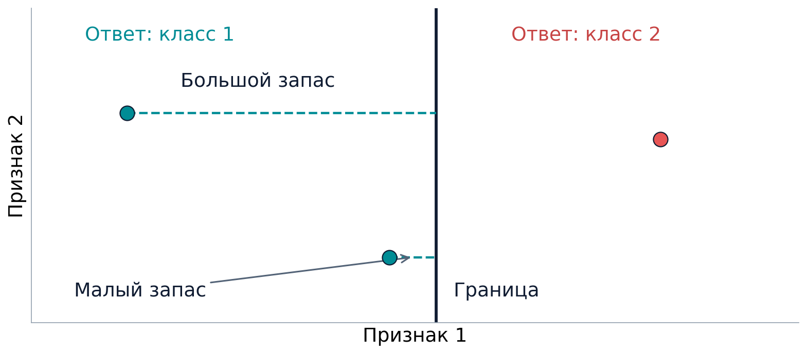
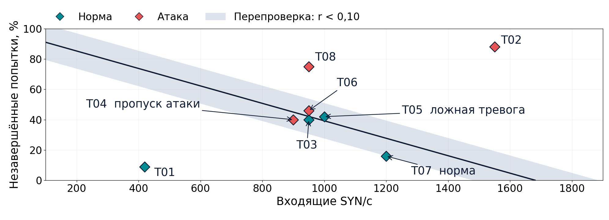

# Разобраться в эталонах, отступах и SVM

Понятное объяснение темы 1.13 и нашего примера с SYN-flood

## Как читать этот документ

Здесь можно начать без знаний машинного обучения. Сначала разберём слова и идеи. Потом последовательно пройдём наш пример с трафиком, включая расчёты и график. В конце посмотрим, что делает код, и проверим понимание на вопросах.

Не нужно запоминать все числа и формулы. Важнее уметь объяснить, что мы сравниваем, как получаем ответ и почему этому ответу иногда нужна проверка. Если формула пока мешает, прочитай пояснение рядом и вернись к ней после практической части.

## Часть I. Сначала смысл и основные понятия

### 1. Какую задачу мы вообще решаем

У нас есть объекты, о которых нужно принять решение. Для каждого объекта программа выбирает одну из заранее заданных групп. В нашей работе такими группами будут обычный трафик и SYN-flood. Но сначала разберём сам принцип, без сетевых чисел.

Программа не понимает ситуацию так, как человек. Мы даём ей числовое описание объекта и правило, по которому нужно выбрать группу. От того, какие свойства мы измерили и какое правило построили, зависит результат.

Тема объединяет несколько вопросов. Как описать объект? С чем его сравнить? Как выбрать класс? Насколько легко этот выбор изменится, если измерения немного поменяются? Ответ на последний вопрос и связан с запасом прочности решения.

### 2. Объект, признаки и класс

**Объектом** называем то, что сейчас исследуем. Один объект должен быть достаточно чётко определён, чтобы мы могли отдельно записать его свойства и отдельно получить для него ответ.

**Признаки** описывают измеримые свойства объекта. Для программы это обычно несколько чисел в определённом порядке. У всех объектов в одной задаче набор признаков должен быть одинаковым. Нельзя у одного объекта первым числом записать скорость, а у другого под тем же названием записать процент.

**Класс** обозначает одну из групп, к которой мы относим объект. Перечень классов задаём заранее. Само слово «класс» не говорит, какая группа лучше или хуже. Это просто возможный ответ.

**Классификация** означает выбор класса по признакам. Здесь легко перепутать две вещи: сами измерения ещё ничего не решают. Чтобы из чисел получилось название класса, нужно правило.

Если признаков два, их удобно представить как координаты точки на листе: первый признак по горизонтали, второй по вертикали. Тогда каждый объект становится отдельной точкой. Точки нужны нам для рисунка. Реальный объект от этого не превращается в геометрическую фигуру, мы просто изображаем его числовое описание.

### 3. Модель, метка и обучение

Правило, которое получает признаки и выбирает класс, называется **классификатором**, или **моделью**. У слова «модель» здесь довольно простой смысл: это способ превратить входные числа в ответ.

Чтобы построить правило по примерам, собирают **обучающую выборку**. В ней для каждого объекта уже известен правильный класс. Такой известный ответ называют **меткой**. В реальной работе метки могут получать из расследования, журналов, проверенного набора данных или контролируемого эксперимента. Они не появляются автоматически из прогноза той же модели.

Во время **обучения** алгоритм подбирает настройки правила по этим примерам. Позже на SVM увидим, как такие настройки задают положение границы. После обучения правило применяют к другим объектам. В этот момент оно получает признаки и выдаёт прогноз. Правильный ответ для нового объекта ему заранее сообщать не требуется.

Метка и прогноз выполняют разные роли. Метка говорит, какой ответ задан или подтверждён в данных. Прогноз показывает, что выбрала программа. Если они не совпали, мы нашли ошибку модели.

Для честной проверки нужны объекты, на которых модель не обучалась. Иначе можно принять запоминание знакомых примеров за способность работать на новых. В нашем учебном разборе проверочные окна тоже будут отдельными, но специально подобранными для объяснения. Поэтому по ним нельзя делать вывод о качестве готового детектора.

### 4. Что называют эталоном

**Эталоном класса называют образец этого класса, выбранный для сравнения с другими объектами.**

Представь, что у каждого класса есть выбранный образец для сравнения. Приходит новый объект. Мы сравниваем его с этими образцами и смотрим, к какому он ближе. Это даёт понятный способ выбрать класс.

Слово «эталон» здесь не означает безупречный объект или гарантированно лучший возможный образец. Оно обозначает роль в нашем методе: этот объект приняли за ориентир для сравнения.

Определение эталона само по себе ещё не объясняет, как его выбрать. Можно взять один образец, несколько образцов или использовать другой способ представления класса. В нашей работе будет по одному образцу на класс, а выбирать их будем специальным правилом. Сначала нужно понять, что вообще значит «ближе».

### 5. Как программа измеряет похожесть

На рисунке расстояние между двумя точками показывает, насколько различаются их признаки. Близкие точки похожи по тем свойствам, которые мы решили измерять. По другим свойствам они при этом могут различаться.

В работе используем **евклидово расстояние**, то есть длину прямого отрезка между точками. Если хочется понять расчёт, он устроен так: находим разницу по первому признаку и разницу по второму, возводим каждую в квадрат, складываем и извлекаем квадратный корень.

Квадраты не дают разницам с разными знаками взаимно уничтожиться. Корень завершает обычный расчёт длины. Это та же идея, что в теореме Пифагора. Для понимания дальнейшего достаточно помнить: маленькое расстояние означает близость в выбранных признаках.

Но сначала нужно выбрать **масштаб**. Если один признак обычно имеет значения в тысячах, а другой от нуля до единицы, большие числа могут почти полностью определять расстояние. Это произойдёт из-за единиц измерения, даже если второй признак содержательно важен.

Поэтому признаки заранее преобразуют. После этого и обучение, и сравнение, и проверку проводят в одном масштабе. Он становится частью метода. Если изменить масштаб и заново построить модель, могут измениться и граница, и ответы. Приведение чисел к похожему порядку само по себе не доказывает, что признаки одинаково важны.

### 6. Как мы выбираем эталон: медоид

**Медоидом называют объект с наименьшей суммой расстояний до остальных объектов своего класса.**

Чтобы найти его, берём первый обучающий объект класса и складываем расстояния от него до всех остальных объектов этого класса. Затем повторяем то же для второго, третьего и остальных кандидатов. Выбираем того, у кого сумма меньше всего.

Так получаем представителя, который в целом близок к своим соседям. Он не обязан быть ближайшим к каждому из них отдельно. Мы сравниваем именно общие суммы.

После этого повторяем процедуру для другого класса. Проверочные объекты в поиск не включаем. Иначе мы заранее использовали бы часть будущей проверки для построения правила.

У медоида есть удобная особенность: он совпадает с одним из существующих примеров. Усреднённые координаты, например, могут не совпасть ни с одним наблюдением. Медоид обязательно можно найти в исходной обучающей таблице.

Сейчас важно разделить два слова. Эталон обозначает, для чего нужен образец. Медоид обозначает конкретный способ его выбрать. В этой работе нашими эталонами становятся медоиды.

### 7. Как работает правило ближайшего эталона

Когда образцы выбраны, правило уже можно применять. Для нового объекта считаем расстояние до каждого эталона и выбираем класс ближайшего.

Если до первого образца расстояние меньше, чем до второго, выбираем первый класс. Если расстояния равны, преимущества нет и нужно заранее оговорить, что делать с таким случаем. Например, отправлять его на дополнительную проверку.

У этого метода тоже есть граница решения: положения, где расстояния до двух образцов равны. По разные стороны этой границы ближе разные эталоны.

Ограничение простого правила в том, что один образец не всегда хорошо описывает весь класс. Внутри класса могут встречаться довольно разные объекты. Нетипичный, но правильный представитель своего класса иногда окажется ближе к чужому образцу.

### 8. Что такое отступ и почему у него бывает минус

**Отступ показывает, насколько оценка правильного класса превосходит оценку другого класса.** Из оценки своего, то есть правильного, класса вычитают оценку конкурента. Здесь рассматриваем два класса, поэтому конкурент один.

Сначала нужно договориться, что называется оценкой. Для ближайшего эталона удобна оценка «минус расстояние». Чем ближе образец, тем выше такая оценка. Например, минус 0,2 больше, чем минус 0,8.

Поэтому для нашего правила получается:

**Отступ по эталонам = расстояние до чужого эталона − расстояние до своего.**

Если свой эталон ближе, из большего расстояния вычитаем меньшее и получаем плюс. Ответ правильный. Если чужой эталон ближе, получаем минус. Ответ ошибочный. Ноль означает равенство расстояний.

В этом определении слово «свой» определяется правильной меткой, а не тем, что предсказала модель. Поэтому знак отступа помогает проверить правильность только там, где правильный класс известен. В реальной работе без метки можно посчитать расстояния и выдать прогноз, но нельзя сразу установить, верен ли этот прогноз.

Положительный отступ не означает атаку. Отрицательный не означает норму. Пока речь о правильности относительно известного класса. Позже у SVM появится отдельное число для выбора класса, и его знак будет выполнять другую задачу.

### 9. Зачем после эталонов нужна SVM

Теперь попробуем другой способ построить правило. **SVM**, или метод опорных векторов, обучается по всей обучающей выборке. В нашем линейном варианте при двух признаках результатом будет прямая, разделяющая плоскость на области выбора классов. Теория метода описана в источниках [1, 2, 5].

Новую точку подставляют в готовое правило и смотрят, по какую сторону границы она находится. По одну сторону модель выбирает один класс, по другую другой.

SVM учитывает положение обучающих примеров. Её задача не сводится к соединению двух эталонов или к проведению линии между их центрами. Эталоны вообще не нужно подавать в SVM вместо всей выборки. Мы используем два самостоятельных способа классификации на одних и тех же данных.

Линейная SVM вычисляет число **f**. На границе оно равно нулю. По разные стороны границы оно имеет разные знаки. Само число f не является вероятностью атаки. Какой знак соответствует какому классу, зависит от выбранного обозначения меток. В практической части мы явно зададим это соответствие.

### 10. Зазор, мягкий зазор и параметр C

Между двумя группами точек часто можно провести много разных прямых. SVM выбирает границу с учётом **зазора**. Так называют полосу между двумя параллельными линиями по обе стороны от границы. Метод стремится сделать эту полосу широкой, одновременно учитывая нарушения со стороны обучающих объектов.

Реальные данные редко разделяются идеально. Некоторые примеры находятся близко к границе, а некоторые могут оказаться на неверной стороне. **Мягкий зазор** позволяет такие нарушения, но назначает за них штраф. Благодаря этому алгоритму не требуется любой ценой идеально разделить все обучающие точки.

Не каждое нарушение зазора означает ошибку класса. Точка может стоять на правильной стороне, но слишком близко к границе и попадать внутрь полосы. Класс выбран верно, а нарушение зазора всё равно есть.

**C** задаёт цену нарушений относительно стремления получить широкий зазор. При прочих равных большой C сильнее наказывает нарушения, маленький разрешает относиться к ним мягче. Нельзя сказать, что увеличение C всегда улучшит результат на новых данных. Параметр подбирают по отдельной проверке.

Число C не является порогом вероятности атаки или расстоянием для отправки объекта аналитику. Значение C = 1 также не означает, что ширина полосы равна единице.

### 11. Кто такие опорные векторы

Слово «вектор» здесь означает набор чисел, которыми описан объект. **Опорные векторы** представляют обучающие примеры, участвующие в определении границы SVM. Обычно это точки на краях зазора или нарушающие его, в том числе трудные примеры внутри полосы.

Не нужно представлять их как два центральных образца классов. Их может быть несколько в каждом классе, они могут находиться в неудобных местах и заметно влиять на положение границы.

| Понятие | Зачем нужно |
| --- | --- |
| Эталон | Образец класса для сравнения |
| Медоид | Способ выбрать такой образец по суммам расстояний |
| Опорный вектор | Обучающий пример, участвующий в построении границы SVM |

Один объект может случайно выполнять обе роли в конкретных данных. От этого сами понятия не становятся одинаковыми.

### 12. Геометрический отступ и запас прочности

После обучения граница уже зафиксирована. Теперь можно измерить самое короткое расстояние от точки до этой границы. Для прямой оно идёт перпендикулярно ей. Это геометрический смысл дальнейших чисел.

**Геометрический отступ γ** представляет такое расстояние со знаком. Если класс выбран правильно, знак положительный. Если модель ошиблась, отрицательный. Для оценки правильности снова нужна известная метка. Нулевое значение γ показывает точку прямо на границе.

**Запас r** представляет расстояние без знака. Он всегда неотрицателен. При известной метке r равен модулю γ, то есть тому же числу после удаления минуса.

Почему это запас прочности? Пока длина изменения признаков меньше r, точка не может пересечь границу готовой линейной модели. Ответ сохраняется. Чем меньше r, тем меньшего изменения достаточно, чтобы дойти до границы. Направление изменения тоже важно: не любой сдвиг одинаковой длины меняет ответ.



Слово «прочность» относится к устойчивости текущего ответа при изменении выбранных признаков. Оно не обещает правильность ответа и не описывает защищённость сервера целиком. Далеко от границы модель тоже способна ошибаться.

Это расстояние, а не вероятность. r = 0,1 не означает 10% вероятности атаки, 90% уверенности или 10% оставшейся мощности сервера. Число имеет смысл только вместе с масштабом и правилом измерения расстояния.

Также не смешиваем два отступа. У эталонов мы считали разность двух расстояний. У SVM теперь измеряем расстояние до её границы. Эти определения различаются, поэтому сравнивать их численные величины напрямую нельзя.

### 13. Пограничный случай и перепроверка

**Пограничным** называем объект рядом с границей. Его ответ легко изменить небольшим изменением признаков. Такой объект может относиться к любому классу, и ответ на нём может быть как верным, так и ошибочным.

Для готовой модели можно задать порог: если расстояние меньше выбранного значения, отправить результат на перепроверку. Это отдельное решение о том, как использовать прогнозы.

У нас появились две разные полосы. Зазор SVM участвует в обучении границы. Полоса перепроверки выделяет близкие к готовой границе ответы уже после обучения. C управляет штрафами при обучении, а порог перепроверки мы выбираем отдельно.

Близость к границе не означает высокий общий риск. Атака, которую модель уверенно относит к атакам, может лежать далеко от линии. Её всё равно нужно заметить. Поэтому список подозрений на атаку и список пограничных случаев должны существовать отдельно.

## Часть II. Один пример от трафика до решения

### 14. Что происходит при SYN-flood

При обычном установлении TCP-соединения клиент отправляет SYN. Сервер отвечает SYN-ACK. Клиент завершает рукопожатие пакетом ACK. После этого стороны могут обмениваться данными.

При SYN-flood сервер получает много начатых подключений, которые не завершаются. В зависимости от реализации и включённых средств защиты они могут занимать ресурсы для незавершённых соединений. Обычным клиентам становится труднее подключиться. Подробно этот механизм разбирается в RFC 4987 [4].

Но большое число SYN бывает и при наплыве обычных пользователей. Потери пакетов тоже могут мешать завершению рукопожатия. Поэтому одного признака «SYN много» недостаточно для окончательного вывода об атаке.

В нашем разборе нет запуска атаки или захвата реального трафика. Все числа заданы вручную, чтобы на них было удобно понять методы и увидеть ошибки.

### 15. Что у нас является объектом и признаками

Один объект представляет трафик к одному IP и TCP-порту за 10 секунд. Такой отрезок наблюдения называем **окном**. Мы выбираем класс для окна целиком, а не для каждого пакета отдельно.

Измеряем два признака:

1. **SYN/с**: сколько входящих SYN-пакетов в среднем приходит за секунду окна. Повторные SYN здесь тоже учитываются.
2. **Незавершённые попытки, %**: какая доля начатых в окне попыток не завершила рукопожатие за 3 секунды. Повторы одной попытки объединяем, чтобы не считать их разными попытками.

Для такого измерения нужно видеть оба направления трафика и дождаться срока наблюдения последней попытки. Если в окне вообще не было SYN, доля для него не определена. Такие окна исключаем из нашего учебного классификатора.

Для обучения задаём 20 окон: 10 нормальных и 10 с атакой. Ещё 8 окон используем для разбора готовых ответов. Их названия T01, T02 и так далее являются идентификаторами строк, а не дополнительными признаками модели.

### 16. Как приводим числа к масштабу

В расчётах делим SYN/с на 1000, а проценты на 100. Например, 1200 SYN/с превращаются в 1,20, а 16% в 0,16. Это всё те же измерения, записанные другими числами.

Число 0,16 в нашем признаке означает долю незавершённых попыток, то есть 16%. Позже число около 0,102 будет обозначать расстояние до границы. Похожие десятичные записи ещё не означают одинаковый смысл.

Делители 1000 и 100 выбраны для этого примера. Это не универсальный стандарт обнаружения SYN-flood. Мы фиксируем их заранее и одинаково используем при выборе эталонов, обучении SVM и проверке новых окон.

### 17. Какие эталоны получились

По обучающим окнам нашли медоид каждого класса. Получились два образца:

| Класс | Эталон | SYN/с | Не завершены | После преобразования |
| --- | --- | --- | --- | --- |
| Норма | N05 | 600 | 15% | (0,60; 0,15) |
| SYN-flood | A06 | 1300 | 65% | (1,30; 0,65) |

Мы не объявили 600 и 1300 порогами безопасности. Это координаты выбранных образцов. Классификатор будет сравнивать расстояния по двум признакам вместе.

В Colab для каждого кандидата вычислены суммы расстояний внутри его класса. У N05 и A06 они оказались минимальными в соответствующих группах. Другие данные или другой масштаб могли бы дать другие эталоны.

### 18. Проверяем T07 по ближайшему эталону

У окна **T07** записано 1200 SYN/с и 16% незавершённых попыток. По условию учебной таблицы это обычный трафик. Нам заранее известен правильный класс, поэтому можно проверить ответ модели.

После преобразования точка имеет координаты (1,20; 0,16). Расстояние до N05 получается около **0,600**, до A06 около **0,500**. Значит, ближе эталон атаки. Правило ближайшего эталона отвечает «SYN-flood» и ошибается.

У нормального T07 своим является эталон N05, чужим A06. Поэтому:

**Отступ ≈ 0,500 − 0,600 = −0,100.**

Минус показывает ошибку относительно известной нормальной метки. Он не обозначает класс нормы сам по себе.

Почему так произошло? T07 содержит много SYN, поэтому по этому признаку оно ближе к образцу атаки. Доля незавершённых попыток у него при этом невысокая. Один нормальный образец не смог хорошо представить такой вариант легитимной нагрузки. Два признака и их масштаб вместе дали именно такой результат сравнения.

Для желающих проверить арифметику: до нормы разницы равны 1,20 − 0,60 = 0,60 и 0,16 − 0,15 = 0,01. Корень из суммы 0,60² и 0,01² даёт 0,600083. До атаки разницы равны −0,10 и −0,49; корень из суммы их квадратов даёт 0,500100. Код считает полные значения, а на слайдах мы округляем.

### 19. Обучаем SVM и снова проверяем то же T07

Теперь берём те же 20 обучающих окон и тот же масштаб, но строим другое правило. Используем линейную SVM с C = 1. В библиотеке scikit-learn её реализует класс SVC.

Для обозначения классов выбираем **−1 для нормы** и **+1 для атаки**. Это условные коды. Минус здесь не означает «плохо», а плюс не означает «хорошо».

После обучения SVM вычисляет для T07 оценку f примерно **−0,249**. Отрицательный знак выбирает норму. Для T07 этот ответ верный. Геометрический отступ γ примерно **+0,102**, а расстояние r примерно **0,102**.

Почему у f минус, а у γ плюс? Потому что они отвечают на разные вопросы. Знак f выбирает класс. Знак γ проверяет правильность относительно известной метки. Обычное окно можно правильно отнести к норме, и именно это здесь произошло.

Мы не меняли T07, чтобы улучшить результат. Поменялся способ классификации. SVM обучилась на всех примерах и провела другую границу. На этом окне она помогла. Но один исправленный случай ещё не доказывает, что SVM будет лучше на любом трафике.

### 20. Что практически значит запас 0,102

Это расстояние от T07 до границы в преобразованных координатах. При расчёте могут одновременно меняться оба признака. r показывает длину самого короткого пути от точки T07 до границы. Само число нельзя сразу прочитать как SYN/с или проценты.

Можно посмотреть на границу более привычным способом. Если оставить у T07 частоту 1200 SYN/с и менять только долю незавершённых попыток, граница находится примерно при **27,76%**. Исходно было 16%. Разница составляет около **11,76 процентного пункта**.

Если оставить долю 16% и менять только частоту, граница находится примерно при **1404,52 SYN/с**. Это примерно на **204,52 SYN/с** больше исходного значения.

Это два возможных направления изменения. Минимальное расстояние r допускает совместное изменение обоих признаков, поэтому оно не равно ни одной из этих разниц. Сдвиги до границы также не означают, что трафик действительно стал атакой. Они показывают, когда готовая модель начнёт выбирать другой ответ.

Все эти числа относятся к нашей модели, её масштабу и выбранным признакам. Их нельзя использовать как универсальные ограничения нагрузки на настоящий сервер.

### 21. Считаем отступы для всех восьми окон

Теперь повторяем расчёт для остальных проверок. В таблице показаны округлённые значения. «Класс в данных» означает ответ, который мы задали при составлении учебного примера.

| ID | SYN/с | Не завершены | Класс в данных | Ответ SVM | Отступ γ | Запас r |
| --- | --- | --- | --- | --- | --- | --- |
| T01 | 420 | 9% | Норма | Норма | +0,551 | 0,551 |
| T02 | 1550 | 88% | Атака | Атака | +0,697 | 0,697 |
| T03 | 950 | 40% | Норма | Норма | +0,018 | 0,018 |
| T04 | 900 | 40% | Атака | Норма | −0,043 | 0,043 |
| T05 | 1000 | 42% | Норма | Атака | −0,024 | 0,024 |
| T06 | 950 | 46% | Атака | Атака | +0,034 | 0,034 |
| T07 | 1200 | 16% | Норма | Норма | +0,102 | 0,102 |
| T08 | 950 | 75% | Атака | Атака | +0,285 | 0,285 |

В первую очередь сравни класс в данных с ответом SVM. Ошибки находятся в строках T04 и T05. У них γ отрицательный. У остальных γ положительный.

После этого посмотри на r. В нём нет минуса ни у правильных, ни у ошибочных ответов. Это только расстояние. Если сохранить один столбец r и убрать метки, по нему нельзя восстановить, какие ответы оказались верными.

### 22. Как читать график из ноутбука



По горизонтали отложены входящие SYN/с. Чем правее точка, тем больше их частота. По вертикали находится процент незавершённых попыток. Чем выше точка, тем больше таких попыток.

Цвет показывает класс из условия: бирюзовые точки относятся к норме, красные к атаке. Чёрная линия показывает границу SVM. **Выше линии модель выбирает атаку, ниже норму.** Цвет и сторона линии несут разную информацию: цвет говорит, что задано в данных, сторона показывает ответ программы.

T04 красная, но стоит ниже линии. Значит, атака попала в область ответа «норма». Это пропуск атаки. T05 бирюзовая, но стоит выше линии. Значит, обычный трафик попал в область ответа «атака». Это ложная тревога.

T07 находится ниже линии, на стороне нормы. Здесь ответ совпал с заданным классом. T03 и T06 тоже распознаны верно, но лежат рядом с линией.

Серая полоса выделяет точки с r < 0,10. В неё попали T03, T04, T05 и T06. T07 находится чуть за её пределами: его расстояние около 0,102. Поэтому не стоит называть T07 точкой с большим запасом только потому, что оно не попало в этот список.

Оси графика подписаны в исходных единицах, чтобы их было удобно читать. Расстояния и ширину серой полосы код вычисляет в том масштабе, который мы задали для признаков.

### 23. Почему две ошибки важны для ИБ

У T04 модель пропустила атаку. Такую ошибку называют **ложноотрицательной**, или **false negative (FN)**. Если положительным событием считаем атаку, модель ответила отрицательно там, где атака была.

У T05 модель приняла норму за атаку. Это **ложноположительная ошибка**, или **false positive (FP)**. Она может отнять время аналитика. Если сразу блокировать всё по прогнозу, такая ошибка способна помешать обычным клиентам.

В нашем примере обе ошибки оказались близко к границе и попали в перепроверку. Это полезная иллюстрация, но не гарантия. На других данных модель может ошибаться далеко от границы. Порог расстояния не способен сам по себе найти все реальные ошибки.

### 24. Как использовать результат, не путая два сигнала

В учебной функции triage передаём аналитику два отдельных флага:

- **attack_alert** сообщает, что модель выбрала атаку. Он включается при любом расстоянии до границы.
- **boundary_review** сообщает, что точка близка к границе. Он включается независимо от того, выбрала модель норму или атаку.

При вводе 900 SYN/с и 40% функция отвечает «норма», но включает перепроверку. Это измерения T04. В реальной работе без известной метки мы не смогли бы сразу сказать, что модель здесь пропустила атаку, но малое расстояние дало бы повод проверить ответ.

При вводе 1550 SYN/с и 88% функция отвечает «атака». Точка далеко от границы, но сигнал атаки всё равно включён. Отсутствие флага пограничности не отменяет подозрения на атаку.

Дальше нужен человек и дополнительные данные. SOC, то есть команда мониторинга и реагирования ИБ, сопоставляет сигнал с журналами, доступностью сервиса, очередью соединений и потерями пакетов. Важен и контекст: был ли обычный наплыв пользователей, изменился ли сервис, хорошо ли датчик видит оба направления.

Для рабочей системы нужны реальные данные, проверка на более поздних периодах трафика и оценка цены обеих ошибок. Наш код показывает принцип обработки результатов. Он не принимает окончательное решение о блокировке.

## Часть III. Как понимать код и объяснять работу самому

### 25. Что делают основные строки Colab

**X_train** содержит признаки обучающих объектов. Одна строка соответствует одному окну, два столбца двум признакам. **y_train** содержит известные метки этих же строк.

```python
model = SVC(kernel="linear", C=1,
            tol=1e-10, shrinking=False)
model.fit(X_train, y_train)
```

Первая команда создаёт настройки модели: линейную границу и цену нарушений C = 1. Вторая запускает обучение на примерах. Параметры tol и shrinking относятся к работе численного алгоритма. Для смысла темы важнее понимать, что fit строит правило по всем 20 окнам.

**X_check** содержит признаки восьми проверочных окон. Команда predict выдаёт выбранные классы, а decision_function возвращает числа f для этих окон.

```python
f = model.decision_function(X_check)
r = np.abs(f) / np.linalg.norm(model.coef_)
gamma = y_check * f / np.linalg.norm(model.coef_)
```

В первой строке получаем оценки f. Во второй берём их модуль и переводим в расстояние до границы. В третьей учитываем известные метки y_check, поэтому появляется знак правильности γ.

Массив model.coef_ содержит коэффициенты, с которыми правило использует признаки. При двух признаках это два числа. Если представить их как координаты точки, команда norm посчитает расстояние от начала координат до этой точки. Деление нужно, чтобы из оценки f получить геометрическое расстояние. Подробная причина дана в следующем небольшом дополнении.

### 26. Минимум формул, если о них спросят

Для нашей линейной модели правило имеет вид **f = w₁x₁ + w₂x₂ + b**. Здесь x₁ и x₂ являются преобразованными признаками. Коэффициенты w₁, w₂ и b подобраны во время обучения. Они задают наклон и положение прямой f = 0.

В этой записи функциональный отступ SVM определяют как m = y · f.

Для нашей модели примерно w₁ = 1,216667, w₂ = 2,116667 и b = −2,047500. Длина вектора коэффициентов ‖w‖ примерно равна 2,441425.

Если умножить w₁, w₂ и b на 2, число f тоже удвоится. Его знак и сама граница останутся прежними. Поэтому величину f без дополнительного пересчёта нельзя считать длиной отрезка на плоскости. Деление на ‖w‖ даёт нужное расстояние.

| Обозначение | Формула | Смысл |
| --- | --- | --- |
| f | w₁x₁ + w₂x₂ + b | По знаку выбираем класс |
| y | −1 или +1 | Известная метка объекта |
| m | y · f | Функциональный отступ, знак показывает правильность |
| γ | y · f / ‖w‖ | Геометрический отступ со знаком |
| r | abs(f) / ‖w‖ | Расстояние до границы без знака |

В таблице abs(f) обозначает модуль, то есть величину f без минуса. В коде эту операцию выполняет np.abs. Запись ‖w‖ обозначает длину вектора коэффициентов.

Например, у T07 y = −1 и f ≈ −0,249. Их произведение положительное. После деления на 2,441 получаем γ ≈ +0,102. Для r просто берём положительную величину f и делим на ту же длину коэффициентов.

Это объясняет две разные роли знаков без запоминания таблицы наизусть. Для выбора класса нужна оценка f, а для проверки правильности нужен правильный класс y.

### 27. Как рассказать всю работу своими словами

Можно опереться на такой связный пересказ:

«Мы хотим отличать обычный трафик от SYN-flood. Каждое наблюдение описываем двумя числами: частотой SYN и долей незавершённых подключений. Для каждого класса выбираем образец по обучающим данным. Такое сравнение даёт простой классификатор по ближайшему эталону.

Потом строим линейную SVM на всей обучающей выборке. Она проводит границу между классами. Отдельно измеряем, как близко новое наблюдение находится к этой границе. Это помогает понять, насколько легко изменится ответ модели.

На T07 правило эталонов ошиблось, а SVM ответила правильно. Для восьми окон рассчитали отступы и увидели две ошибки. Окна рядом с границей отправляем на перепроверку, но подозрение на атаку сохраняем при любом расстоянии. Окончательный вывод требует сетевого контекста и проверки аналитиком».

Здесь есть вся логика работы. Если можешь объяснить каждое предложение и показать соответствующее место на графике, ты понимаешь основу темы. Дальше полезно проверить себя вопросами.


## Часть IV. Проверяем, что тема понятна

### Что может спросить преподаватель

#### 1. Почему отдельный SYN ещё не означает атаку?

С SYN начинается обычное TCP-соединение. Подозрение возникает из сочетания признаков: сколько таких сообщений приходит и какая доля попыток остаётся незавершённой. Даже это сочетание нужно проверять по другим данным. В нашем примере объектом служит окно трафика длиной 10 секунд, а не один пакет.

#### 2. Если модель сказала «норма», можно считать, что правильный класс уже известен?

Нет. Прогноз является ответом модели, которая может ошибиться. Правильный класс в учебной таблице задан заранее. У нового трафика такой готовой метки обычно нет. Поэтому мы можем сразу получить прогноз и расстояние до границы, но для установления ошибки нужны дополнительные сведения.

#### 3. Почему эталоном атаки не взяли самый сильный всплеск?

Мы хотим сравнивать наблюдения с представительным образцом класса. Самый сильный всплеск может быть далёк от остальных атак. Медоид выбирается иначе: ищем обучающий объект с наименьшей суммой расстояний до других объектов своего класса. В нашей таблице это A06. Эталон можно выбирать и другим способом, но здесь способ заранее определён.

#### 4. Зачем делить SYN в секунду на 1000, а проценты на 100?

Так задаём масштаб сравнения. Без него числа вроде 1200 могут почти полностью определять расстояние, а разница в доле незавершённых попыток будет мало влиять. Масштаб меняет относительный вес признаков, поэтому способен изменить эталоны и границу SVM. Это часть выбранного метода, а не косметическое оформление таблицы.

#### 5. Эталон и опорный вектор представляют одно и то же?

У них разные задачи. Эталон служит образцом класса. Опорный вектор является обучающим объектом, участвующим в определении границы SVM. Один объект может выполнять обе роли, но это необязательно. Новое проверочное окно не становится опорным вектором только потому, что оказалось рядом с границей: оно не участвовало в обучении.

#### 6. Если SVM правильно распознала T07, доказано ли, что она лучше эталонов?

Для T07 она действительно дала правильный ответ, а правило ближайшего эталона ошиблось. Это результат одного примера. Чтобы сравнить методы в целом, нужны отдельные данные и оценка ошибок. Кроме того, отступ эталонов около минус 0,100 и геометрический отступ SVM около плюс 0,102 нельзя сравнивать как одну шкалу: они вычисляются по-разному.

#### 7. Почему для эталонов вычитают своё расстояние из чужого?

Меньшее расстояние означает большее предпочтение класса, поэтому оценкой класса берём минус расстояние до его образца. Отступ сравнивает оценку правильного класса с оценкой другого. В результате получаем чужое расстояние минус своё. Для нормального T07 это 0,500 минус 0,600. Отрицательный отступ показывает, что выбран чужой класс.

#### 8. Почему у T07 число f отрицательное, а γ положительное?

Эти знаки отвечают на разные вопросы. В нашей кодировке f < 0 выбирает норму, а f > 0 выбирает атаку. Знак γ показывает правильность по известной метке. T07 действительно относится к норме, поэтому при f около минус 0,249 его γ положительно и равно примерно 0,102. Противоречия здесь нет.

#### 9. Что потеряется, если вместо γ показывать только r?

Расстояние r равно модулю γ. Оно сохраняет близость к границе, но теряет знак правильности. Для T05 γ около минус 0,024, а r около 0,024. По расстоянию видно, что точка близка к границе. Об ошибке узнаём из отрицательного γ, для которого нужна правильная метка.

#### 10. Может ли модель ошибиться далеко от границы?

Модель может ошибиться и далеко от границы. Большое r говорит, что для достижения границы нужно сильнее изменить признаки. Если ответ уже ошибочный, небольшие изменения сохранят именно его. Поэтому расстояние не является вероятностью правильного ответа и не доказывает защищённость сервера.

#### 11. Почему C=1 и порог перепроверки 0,10 нельзя считать одной настройкой?

C используется во время обучения. Он задаёт цену нарушений зазора и может изменить положение границы. Порог 0,10 применяем после обучения к уже посчитанному расстоянию. Он определяет, какие окна отправить на дополнительную проверку. Можно поменять этот порог, сохранив ту же обученную модель.

#### 12. Если обучающая точка находится внутри зазора SVM, модель обязательно ошиблась?

Нет. Точка может находиться на правильной стороне границы, но слишком близко к ней. Тогда прогноз верный, хотя требование к величине отступа нарушено. Мягкий зазор допускает и такие случаи, и ошибки на неверной стороне. Поэтому число нарушений зазора и число ошибок могут различаться.

#### 13. Если пограничная проверка не нужна, сигнал атаки тоже можно выключить?

Нет. Это два отдельных условия. Для окна с 1550 SYN в секунду и 88% незавершённых попыток SVM предсказывает атаку, а r около 0,697. Оно далеко от границы, но сигнал атаки нужен. Отсутствие флага пограничности означает только, что окно не попало в выбранную узкую полосу.

#### 14. Почему двух признаков может не хватить для обнаружения SYN-flood?

Похожие значения возникают по разным причинам. Число SYN растёт при обычном наплыве клиентов, а доля незавершённых попыток увеличивается при потерях, задержках или неполном сборе трафика. Два числа не показывают весь контекст. Аналитик проверяет журналы, доступность сервиса, очередь подключений и динамику нескольких окон.

#### 15. Что нужно сделать, прежде чем говорить о качестве на реальной сети?

Собрать реальные наблюдения с подтверждёнными метками. Разделить обучение, настройку и итоговую проверку по времени и сеансам. Эталоны выбирать по обучающим данным. Параметры модели и порог перепроверки настроить на отдельной части. Затем измерить пропуски, ложные тревоги, задержку и объём ручной проверки. Наши восемь иллюстраций этого испытания не заменяют.

### Минисамопроверка

Сначала ответьте своими словами, не заглядывая в следующий раздел. Важнее объяснить причину ответа, чем вспомнить формулировку.

1. Пришло окно с 900 SYN в секунду и 40% незавершённых попыток. Какие два числа получит модель после нашего масштабирования?
2. T07 по условию является нормой. До нормального эталона расстояние 0,600, до атакующего 0,500. Какой класс выберет правило и какой знак будет у отступа?
3. Для того же T07 SVM получила f около минус 0,249 и предсказала норму. Какой знак должен иметь γ? Почему?
4. У T05 γ около минус 0,024. Чему равно r и можно ли назвать ответ правильным?
5. Для T07 прогноз «норма», r=0,101921, порог перепроверки 0,10. Какие два флага включатся? Доказывает ли это отсутствие опасности?
6. Для T02 прогноз «атака», r около 0,697. Какие флаги включатся при том же пороге?
7. Порог перепроверки уменьшили с 0,10 до 0,02. Надо ли заново обучать SVM? Какие из восьми окон останутся пограничными?
8. Соседние окна одного сеанса случайно распределили между обучением и итоговой проверкой. Почему хороший результат может ввести в заблуждение?

### Ответы к самопроверке

#### 1. Получим 0,90 и 0,40

Скорость делим на 1000, процент на 100. Доля 0,40 соответствует 40%, а не 0,40%. Этот масштаб должен одинаково применяться при обучении и при получении новых прогнозов.

#### 2. Будет выбрана атака, отступ отрицательный

Атакующий эталон ближе. Для известного нормального класса считаем чужое расстояние минус своё: 0,500 минус 0,600, около минус 0,100. Получается ошибка относительно заданной метки.

#### 3. γ должен быть положительным

Прогноз совпал с известной нормальной меткой. Отрицательное f выбирает класс «норма», а положительное γ показывает, что этот выбор верен. Это разные значения с разным смыслом.

#### 4. r около 0,024, ответ ошибочный

Расстояние получаем, убирая знак у γ. Отрицательный γ означает ошибку. Малое положительное r говорит о близости к границе, но не отменяет ошибку.

#### 5. Оба флага выключены

Прогноз нормы не создаёт сигнал атаки. Расстояние немного больше 0,10, поэтому флаг пограничной проверки тоже не ставится. Эти два условия не доказывают безопасность: модель оценивает только выбранные признаки и может ошибаться.

#### 6. Сигнал атаки включён, пограничная проверка выключена

Сигнал атаки следует из прогноза. Большое расстояние не отменяет его. Здесь r больше 0,10, поэтому дополнительного флага пограничности нет.

#### 7. Повторное обучение не требуется; останется T03

Меняем правило обработки готовых расстояний, а не сам классификатор. У T03 r около 0,018. У T05 около 0,024, у T06 около 0,034, у T04 около 0,043, поэтому они уже не проходят порог 0,02. Прогнозы модели и сигналы атаки от смены этого порога не меняются.

#### 8. Части данных могут оказаться слишком похожими

Модель проверяют на наблюдениях, тесно связанных с уже виденными при обучении. Такая проверка слабо показывает работу на новых условиях. Поэтому связанные окна одного сеанса разделять между этими частями не следует, а для будущего трафика полезна проверка по времени.


## Где посмотреть исходные материалы

[Открыть наш ноутбук в Google Colab](https://colab.research.google.com/github/johnnilson664-sys/gis/blob/main/presentations/1.13-etalony-otstupy/SYN_flood_etalony_otstupy.ipynb). В нём находятся исходные таблицы, расчёты и сохранённые графики. Для пересчёта выберите «Среда выполнения → Выполнить все».

[Открыть материалы презентации на GitHub](https://github.com/johnnilson664-sys/gis/tree/main/presentations/1.13-etalony-otstupy). Презентация содержит краткую версию доклада. Этот документ объясняет тему подробнее и помогает подготовиться к вопросам.

Основные источники для определений и методов:

1. [Cortes и Vapnik, Support-vector networks, 1995](https://doi.org/10.1007/BF00994018). Исходная работа по SVM.
2. [Stanford CS229, заметки по SVM](https://see.stanford.edu/materials/aimlcs229/cs229-notes3.pdf). Функциональный и геометрический отступы, мягкий зазор.
3. [Schubert и Rousseeuw, Faster k-Medoids Clustering, 2019](https://arxiv.org/abs/1810.05691). Выбор медоидов по расстояниям.
4. [RFC 4987, TCP SYN Flooding Attacks and Common Mitigations](https://www.rfc-editor.org/rfc/rfc4987.html). Механизм SYN-flood и способы противодействия.
5. [Документация scikit-learn по SVM](https://scikit-learn.org/stable/modules/svm.html). Реализация и работа с признаками.
6. [Moosavi-Dezfooli и соавторы, DeepFool, 2016](https://www.cv-foundation.org/openaccess/content_cvpr_2016/papers/Moosavi-Dezfooli_DeepFool_A_Simple_CVPR_2016_paper.pdf). Связь расстояния до границы с изменением признаков.
7. [CICDDoS2019](https://www.unb.ca/cic/datasets/ddos-2019.html). Возможные данные для дальнейшей проверки. В нашем расчёте этот набор не использован.
8. [NIST SP 800-94](https://csrc.nist.gov/pubs/sp/800/94/final). Обнаружение вторжений и проверка тревог.
